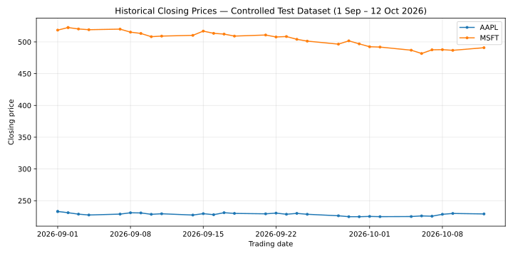

# Verified test run — 26 November 2026

Controlled test dataset (Report §5.1): AAPL + MSFT, 30 business days,
1 Sep – 12 Oct 2026. 68 rows = 60 clean + 2 duplicates + 6 faults.
Run on this machine with SQLite (same schema + same ON CONFLICT UPSERT
as PostgreSQL). Timings are local test-run timings and vary by machine.

## Pipeline

```
$ python -m src.pipeline --rerun-upsert
Source:            Controlled test dataset (sample_stock_data.csv) — not a live API feed
Symbols:           AAPL, MSFT
Date range:        2026-09-01 to 2026-10-12
Records retrieved: 68
Records validated: 62
Records loaded:    60
Rejected records:  6 {'DQ-03': 2, 'DQ-04': 1, 'DQ-05': 1, 'DQ-01': 1, 'DQ-02': 1}
Duplicates:        2
UPSERT re-run:     60 updated, total still 60
Execution time:    0.13022s (extract 0.00635s, transform 0.014315s, load 0.10571s)
Pipeline status:   Completed (test run)
```

Reconciliation: 60 loaded + 6 rejected + 2 duplicates = 68 retrieved.
Per symbol: AAPL 30 rows (2026-09-01 to 2026-10-12), MSFT 30 rows (same range).
Daily returns: 58 non-null (first row per symbol has no previous close).

## Tests

```
$ python -m pytest tests/ -v
13 passed in 0.57s
```

- test_extract: 68 rows loaded (TC-01); empty source handled, 0 rows (TC-02)
- test_transform: columns/types standardised; 'N/A' close rejected (TC-03);
  malformed date 2026-13-40 rejected (TC-04); validation counts 62 valid / 6 rejected
- test_validate: each of DQ-01…DQ-05 rejects its fault; clean row passes;
  duplicates flagged, not rejected (DQ-06, handled at load)
- test_load: 60 inserted, 0 updated, 2 duplicates skipped (TC-05);
  re-run 60 updated, total still 60 (TC-06); bad connection raises (TC-07);
  analytics 58 non-null daily returns (TC-08)

## Chart



Full machine-readable summary: `run_summary.json` in this folder.
